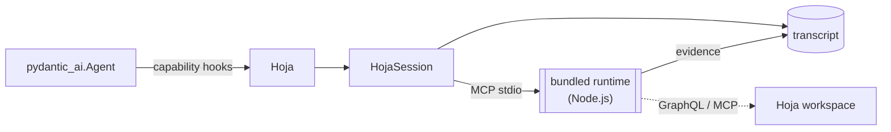

<div align="center">


# Hoja for Pydantic AI

**Tasks that can't be marked done without proof, as one Pydantic AI capability.**
TaskManage, an evidence-checked task gate, Hoja issue sync and session traces, for any `pydantic_ai.Agent`.

[](LICENSE)
[](https://pydantic.dev/docs/ai/)
[](pyproject.toml)
[](src/pydantic_ai_hoja/py.typed)
[](https://github.com/hoja-work/hoja-code-puppy-plugin)
[](https://github.com/hoja-work/hoja-claude-plugin)

</div>

---

```python
from pydantic_ai import Agent
from pydantic_ai_hoja import Hoja

agent = Agent("anthropic:claude-sonnet-4-5", capabilities=[Hoja()])
```

Agents say "done" too easily. With `Hoja()` on an agent:

- **Every task has acceptance questions.** "Do the tests pass?" "Is the README updated?", written up front.
- **Completion needs evidence that resolves.** Each answer cites `src/app.py#L10-L40`, `README.md#Install` or
  `tool:Bash#3`: a real file, or a real tool result from *this* run. Made-up evidence is rejected.
- **Nothing mutates without a task.** Until a task is focused, the gate refuses acting tool calls and the model reads
  why. Reads are always free.
- **Your tracker stays current by itself.** In Hoja mode each top-level task becomes a Hoja issue, its progress is
  rewritten in place, and an evidenced completion moves it to Done, with the session trace attached.

This is not a re-implementation. The gate, TaskManage and Hoja mode are the same runtime the
[Claude Code](https://github.com/hoja-work/hoja-claude-plugin), [Codex](https://github.com/hoja-work/hoja-codex-plugin)
and [Antigravity](https://github.com/hoja-work/hoja-antigravity-plugin) plugins run, shipped byte for byte and
hash-checked. This package translates Pydantic AI's capability hooks into the runtime's events.

## Contents

- [Install](#install)
- [Quick start](#quick-start)
- [What you get](#what-you-get)
- [Configuration](#configuration)
- [Recipes](#recipes)
- [How it works](#how-it-works)
- [Troubleshooting](#troubleshooting)
- [Development](#development)

## Install

```bash
uv add pydantic-ai-hoja        # or: pip install pydantic-ai-hoja
```

You also need **Node.js 22+** on `PATH` (or set `HOJA_NODE`), because the runtime is the shared TypeScript engine,
bundled. Python 3.11+ and `pydantic-ai-slim` 2.64 or later.

## Quick start

1. **Sign in (optional).** Sign in once with the Hoja CLI; the runtime asks it for a fresh token and the workspace's
   endpoints and refreshes it on expiry:
   ```bash
   hoja auth login acme.hoja.work
   ```
   Or export credentials: `HOJA_API_URL=https://acme.hoja.work/graphql HOJA_TOKEN=… HOJA_PROJECT="My Project"`.
   Without credentials, TaskManage and the gate still work and publication is skipped.
2. **Add the capability** to any agent, as above.
3. **Run it.** Try the bundled example with `clai`:
   ```bash
   uvx --with pydantic-ai-hoja clai --agent examples.coding_agent:agent
   ```

What the model sees on its first unplanned write:

```text
shell: Tool 'Bash' blocked by hook: [TASK ENFORCEMENT - BLOCKED] YOU CANNOT EXECUTE ANY TOOL WITHOUT A TASK …
```

It then creates a task with `TaskManage`, focuses it, does the work, and completes it with evidence the runtime checks.

## What you get

| | |
| --- | --- |
| **`TaskManage`** | Ordered, durable tasks with dependencies, sub-tasks, notes and 1–12 acceptance questions each. Completion is validated against the workspace and this run's tool results. |
| **Task gate** | `wrap_tool_execute` asks the runtime before every tool call. `block` (default) refuses acting tools without a focused task; `advise` only nudges. Read-only tools, read-only shell commands and Hoja reads are always allowed. |
| **Reminders** | Completion and task-maintenance nudges reach the model through `RunContext.enqueue`, so they stay in the message history. |
| **Auto-continue** | When the model ends its turn right after a gate block, the runtime's continuation is sent as an `asap` follow-up within its own bounded budget. It spends none of your output-retry budget. |
| **Hoja mode** | `hoja_list`, `hoja_get`, `hoja_project` and automatic publication: one issue per coarse task, acceptance questions in the description, an evidence comment and Done on completion. |
| **Hosted Hoja API** | The workspace's full MCP API (issues, comments, decisions, projects, cycles). Its read tools are exempt from the gate; its writes are gated. |
| **Session traces** | Turns, model calls with token usage, and every tool call with its outcome, as a `hoja.trace/v1` trace attached to the linked issue on completion. |
| **Commands** | `/hoja:tasks`, `/hoja:hoja on\|off\|status`, `/hoja:trace [upload ISSUE\|path]`, `/hoja:setup`. Sent as the prompt, they are answered locally with no model call. Also `Hoja.command("tasks")`. |

## Configuration

Every option is a `HojaSettings` field, read from the environment by default:

```python
from pydantic_ai_hoja import Hoja, HojaSettings

Hoja(settings=HojaSettings.from_env(enforcement="advise", hosted_api=False), cwd="path/to/repo")
```

| Variable | `HojaSettings` field | Default | Purpose |
| --- | --- | --- | --- |
| `HOJA_API_URL` | `api_url` | Hoja CLI sign-in | GraphQL endpoint, e.g. `https://acme.hoja.work/graphql` |
| `HOJA_MCP_URL` | `mcp_url` | derived | Hosted MCP endpoint |
| `HOJA_TOKEN` | `token` | Hoja CLI sign-in | Personal API token |
| `HOJA_PROJECT` | `project` | `.pi/config/hoja.json` | Default project for publication |
| `HOJA_TASK_ENFORCEMENT` | `enforcement` | `block` | `block` · `advise` · `off` |
| `HOJA_TRACE_UPLOAD` | `trace_upload` | `completion` | `completion` · `session-end` · `manual` · `off` |
| `HOJA_TRACE_DETAIL` | `trace_detail` | `full` | `full` (secret-scrubbed) · `metadata` (timings and counts only) |
| `HOJA_PLUGIN_DISABLE_HOJA=1` | `hoja_mode=False` | on | Keep tasks local; no publication |
| `HOJA_DISABLE_HOSTED_API=1` | `hosted_api=False` | on | Leave out the hosted API's tools |
| `HOJA_HEADLESS=1` | `headless=True` | off | Unattended-job semantics for the gate |
| `HOJA_DATA_DIR` | `data_dir` | `~/.local/share/hoja/pydantic-ai` | Journals, transcripts, traces |
| `HOJA_NODE` | `node` | `node` | Node.js 22+ executable |
| `HOJA_DEBUG_LOG` | `debug_log` | — | Append every hook and tool call to this file |

`Hoja(...)` itself takes `cwd` (where evidence resolves), `session` (share one session between agents),
`tool_aliases`, `gate`, `auto_continue`, `include_tools` and `include_instructions`.

## Recipes

**Map your own tool names.** The gate knows tools by their Claude Code names (`Bash`, `Read`, `Edit`, …). Common
Python names (`shell`, `run_shell_command`, `read_file`, `write_file`, `grep`, …) are mapped already; add yours:

```python
Hoja(tool_aliases={"run": "Bash", "open_file": "Read"})
```

A shell tool should take its command line as `command` (or `cmd`), so read-only commands like `ls` and `git log` stay
free.

**One session for a coordinator and its subagents**, so they share one task list:

```python
from pydantic_ai_hoja import Hoja, HojaSession

session = HojaSession()
lead = Agent(model, capabilities=[Hoja(session=session)])
worker = Agent(model, capabilities=[Hoja(session=session)])
```

**Just the tools, no gate:**

```python
from pydantic_ai_hoja import HojaSession, hoja_toolset

agent = Agent(model, toolsets=[hoja_toolset(HojaSession())])
```

**Commands from code:**

```python
hoja = Hoja()
print(hoja.command("tasks"))
print(hoja.command("trace", "upload HOJA-123"))
```

## How it works



The capability forwards each moment of the agent loop to the runtime as a hook event (`UserPromptSubmit`,
`PreToolUse`, `PostToolUse`, `PostToolBatch`, `Stop`) and acts on the answer. It also writes the run's transcript in
the format the runtime reads, so `tool:Bash#2` evidence resolves exactly as it does in Claude Code. The full mapping
is in [docs/architecture.md](docs/architecture.md).

## Troubleshooting

| Symptom | Fix |
| --- | --- |
| `HojaRuntimeError: Node.js 22+ is required` | Install Node.js 22+, or point `HOJA_NODE` at it. |
| A tool you consider read-only is refused | Map it to a read name with `tool_aliases` (`{"cat_file": "Read"}`), or use `enforcement="advise"`. Unknown tools are gated by design. |
| Tasks are not published | Send `/hoja:setup` and `/hoja:hoja status`. Publication needs credentials and a resolvable project. |
| Every run starts a fresh task list | Each `Hoja()` makes a new session. Reuse the capability (or one `HojaSession`) across runs. |
| You want to see the hook traffic | Set `HOJA_DEBUG_LOG=/tmp/hoja.log`, or enable `logging` for `pydantic_ai_hoja`. |

## Development

```text
src/pydantic_ai_hoja/
├── capability.py        the Hoja capability (Pydantic AI hooks → session)
├── toolset.py           the runtime's tools as a FunctionToolset
├── runtime/             host-agnostic; also used by the Code Puppy plugin
│   ├── session.py       HojaSession: hooks in, decisions out
│   ├── rpc.py           JSON-RPC over stdio on a thread
│   ├── names.py         host tool names → Claude Code names
│   ├── transcript.py    Claude Code-format transcript writer
│   ├── settings.py      HojaSettings (HOJA_* variables)
│   └── bundle.py        bundle location, Node.js check
└── _bundle/             vendored runtime (never edit; re-vendor)
tests/                   unit tests + end-to-end runs against the real runtime with a scripted model
examples/                a clai-ready coding agent
docs/                    architecture
scripts/vendor_bundle.py re-vendor or verify the bundle
```

```bash
uv sync
uv run python scripts/vendor_bundle.py --check   # bundle files match MANIFEST.json (SHA-256)
uv run pytest                                    # no model provider or Hoja workspace needed
uv run ruff check . && uv run ruff format --check . && uv run pyright
```

To pick up a new runtime: `uv run python scripts/vendor_bundle.py --from ../hoja-claude-plugin`, then run the tests.

## License

[MIT](LICENSE). The bundled runtime comes from [hoja-work/hoja-claude-plugin](https://github.com/hoja-work/hoja-claude-plugin)
and includes unmodified code from [cloverinternational/trebol](https://github.com/cloverinternational/trebol). See
[NOTICE](NOTICE).
