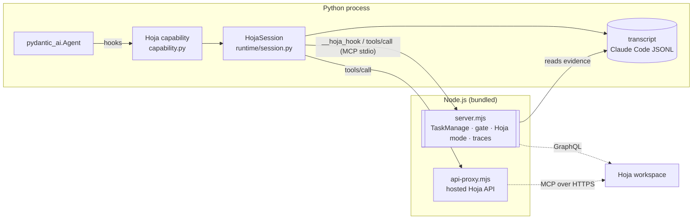

# Architecture

`pydantic-ai-hoja` is an adapter. Every decision (whether a tool call may run, whether a completion's evidence is
real, what gets published to Hoja, when an ended turn is sent back to work) is made by the **Hoja runtime**, the same
code the Claude Code, Codex and Antigravity plugins run. This package moves events in and decisions out.

## Layers

| Layer | Module | Knows about |
| --- | --- | --- |
| Host adapter | `capability.py`, `toolset.py` | Pydantic AI's capability hooks |
| Session | `runtime/session.py` | the runtime's hook dialect; nothing about any Python host |
| Transport | `runtime/rpc.py` | JSON-RPC over stdio, on a thread, usable from any event loop or none |
| Translation | `runtime/names.py`, `runtime/transcript.py` | Claude Code tool names and transcript format |
| Configuration | `runtime/settings.py`, `runtime/bundle.py` | `HOJA_*` variables, Node.js, the vendored files |

`pydantic_ai_hoja.runtime` imports nothing from Pydantic AI, so another host (the
[Code Puppy plugin](https://github.com/hoja-work/hoja-code-puppy-plugin)) builds on it directly.

## Event mapping

| Pydantic AI seam | Runtime hook | Effect |
| --- | --- | --- |
| `wrap_run` (prompt) | `UserPromptSubmit` | context for the first request; `/hoja:<cmd>` answered with no model turn |
| `get_instructions` | `session-start.mjs` | TaskManage workflow, completion contract, Hoja-mode rules |
| `get_toolset` | `tools/list` | TaskManage, `hoja_*` tools, the hosted API |
| `wrap_tool_execute` | `PreToolUse` → `PostToolUse` / `PostToolUseFailure` | block with the reason, or run and report |
| `before_model_request` | `PostToolBatch` | the turn's queued reminders, via `RunContext.enqueue` |
| `after_model_request` (final text) | `Stop` | an `asap` follow-up when the turn ended on a resolvable block |
| `close()` / interpreter exit | `SessionEnd` | journal flushed, trace finalized |

## Why the transcript

The runtime validates `tool:<Name>#<n>` evidence against the session's real tool results and classifies an ended
turn by reading the host's transcript. Pydantic AI keeps its history in memory, so the adapter writes the same facts
to `<data_dir>/transcripts/<session>.jsonl` in Claude Code's format, which the runtime already parses. One model
response is one message id; its tool calls are written by the gate under that id, so a blocked call is recorded even
though it never ran.

## Why Node.js

The runtime is Trebol's TypeScript, vendored unmodified and hash-checked in the Claude Code plugin, then bundled.
Porting it to Python would create a second implementation of the gate and the evidence rules that could drift.
Shipping the bundle keeps exactly one, at the cost of a Node.js 22+ requirement.
